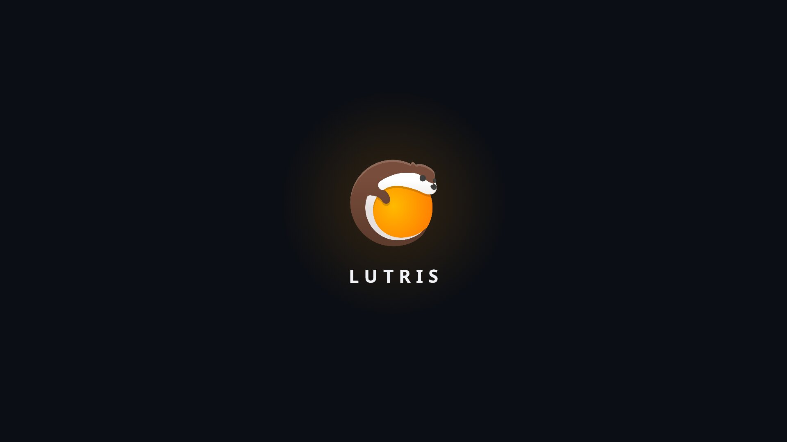
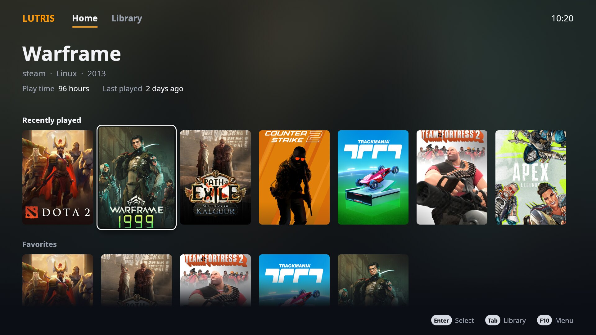
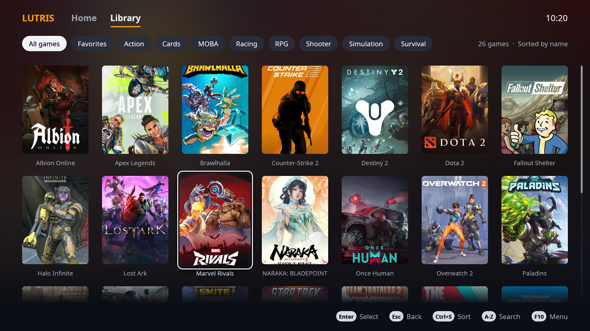
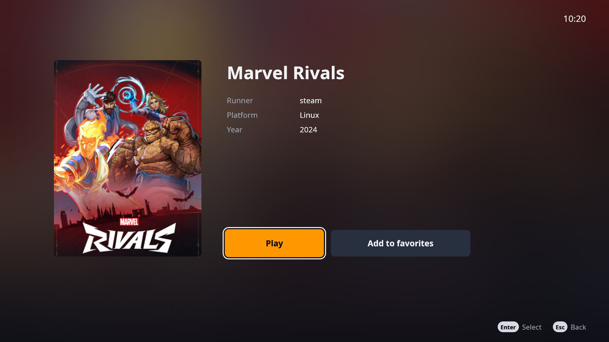
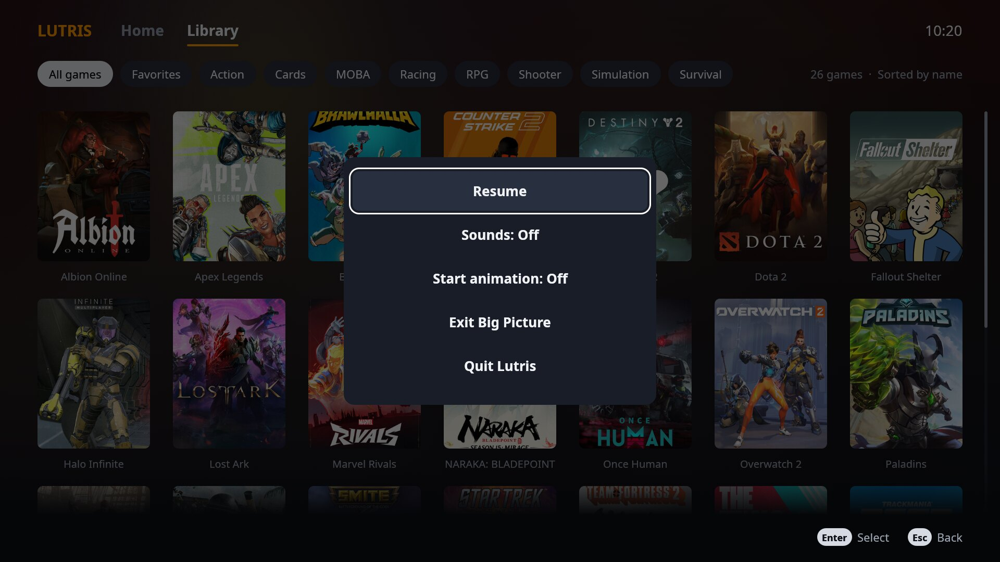
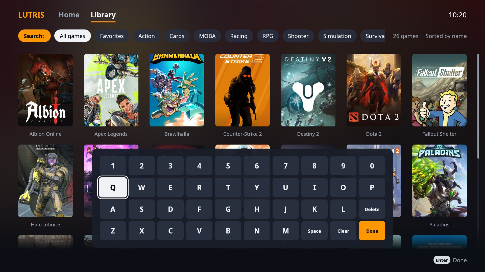

# Lutris Big Picture

The interface of Lutris's Big Picture mode: a fullscreen view of the game
library, made for a controller and a television. Keyboard and mouse work too.

It is a program of its own, `lutris-bigpicture`, written in Rust. Lutris
starts it, tells it what is in the library, and carries out what the user
asks for; the program itself only draws and listens.

## Screenshots

The games shown are free-to-play titles, used as a dummy library.

| | |
|---|---|
|  |  |
| It opens with the Lutris icon rolling in. | **Home:** what was played or added lately, and the favorites. |
|  |  |
| **Library:** every game, filtered by runner or category, and sorted. | **A game's page**, with its backdrop made from the cover. |
|  |  |
| **Menu:** sounds, the start animation, and the way out. | **Search**, with a keyboard on screen. |

## Using it

Enter Big Picture mode with the television button in the Lutris header bar,
with F11 in the Lutris window, or by starting `lutris --big-picture`. Leave it
from its menu.

| What | Xbox | PlayStation | Nintendo | Keyboard |
|---|---|---|---|---|
| Move | D-pad or left stick | | | Arrow keys |
| Select | A | Cross | B | Enter |
| Back | B | Circle | A | Esc |
| Home / Library | LB / RB | L1 / R1 | L / R | Shift+Tab / Tab |
| Sort (in the library) | X | Square | Y | Ctrl+S |
| Search | Y | Triangle | X | Ctrl+F, or just type in the library |
| Menu | Menu | Options | + | F10 |
| Page up / down | LT / RT | L2 / R2 | ZL / ZR | Page Up / Page Down |
| Fullscreen on / off | | | | F11 |
| Leave | from the menu | | | Ctrl+Q |

The hints at the bottom of the screen name the buttons of the controller in
use, or the keys if the keyboard was used last.

## Building

It needs a Rust toolchain (Rust 1.95 or later) and the development files of
ALSA and udev; `INSTALL.rst` at the top of the source tree names the packages.
From the top of the source tree:

    make bigpicture         # builds bigpicture/target/release/lutris-bigpicture
    make bigpicture-check   # formatting, lints and tests

Lutris run from the source tree finds the build by itself. The `bigpicture`
option of the Meson build installs it next to `lutris`, and the AppImage
comes with it. The Debian and RPM packages do not build it yet; where the
program is missing, Lutris leaves the Big Picture button out.

## How it works with Lutris

Lutris starts the program as a child process and speaks to it in lines of
JSON: Lutris writes to the program's standard input, and reads its requests
from its standard output. `src/protocol.rs` describes every message.

- Lutris sends the translated text and the sound settings (`init`), the
  library (`library`), what a game is doing (`game_state`), and errors to
  show (`error`).
- The program asks to `launch` or `stop` a game, to make it a favorite
  (`set_favorite`), and to remember the chosen sounds and whether to play the
  start animation (`set_sound_pack`, `set_splash`).
- Leaving is not a message: the program exits, and its exit status says
  whether Lutris should bring its window back or quit as well.

The Lutris side of this is `lutris/gui/bigpicture.py`.

To try the program without Lutris, start it with `--windowed` and type the
messages into its standard input; `--help` lists its options.

## The source

| File | What is in it |
|---|---|
| `src/main.rs` | Options, and the window |
| `src/app.rs` | The state, the input handling, and the screens |
| `src/draw.rs` | Drawing helpers the screens share: text, tiles, buttons |
| `src/input.rs` | Controllers: their buttons, sticks, and what they are called |
| `src/covers.rs` | Loading cover images in the background |
| `src/sounds.rs` | Navigation sounds and sound packs |
| `src/splash.rs` | The start animation |
| `src/protocol.rs` | The messages exchanged with Lutris |

Sizes in the drawing code are in units of one pixel on a 1080p screen, and
scale with the screen.

## Start animation

It opens with a short animation of the Lutris icon, which any button cuts
short; the *Start animation* entry of the menu switches it off for good.

## Steam

If Steam is running, it reads the controller too and would turn its buttons
into key presses of its own. Big Picture mode asks Steam to leave the
controller alone while it is in front, and hands it back when a game starts
and when the mode is left; nothing needs to be set up in Steam for this.

## Navigation sounds

Moving around makes quiet sounds. The *Sounds* entry of the menu switches
between the sound packs that are installed, and no sounds at all.

A sound pack is a directory holding one audio file for each sound, named
after the sound:

| File | When it is played |
|---|---|
| `move` | The focus moved |
| `select` | Something was chosen |
| `back` | Going back, or closing something |
| `tab` | Switching between the home screen and the library |
| `open` | The menu or the on-screen keyboard opened |
| `key` | A character was typed |
| `toggle` | A setting was switched, such as a favorite or the sorting |
| `launch` | A game is being launched |
| `error` | Something went wrong |

Ogg Vorbis is the format to use, as it keeps the files small; WAV and MP3 are
read as well. Keep the files short: they are played in full, over each other
if need be.

The sounds Lutris comes with are such a pack, called `default`, in
`share/lutris/bigpicture/sounds`. To make your own, copy that directory to
`~/.local/share/lutris/bigpicture/sounds` under another name, for example
`~/.local/share/lutris/bigpicture/sounds/arcade`, and replace the files you
want to change. A pack need not have every sound: what it leaves out is taken
from the default pack. An optional `pack.json` in the directory can name the
pack, turn it down, and silence sounds instead:

    {"name": "Arcade", "volume": 0.8, "silent": ["key"]}

A pack of your own that is called `default` takes the place of Lutris's.

The default sounds were made for Lutris by `tools/make_sounds.py`, which
synthesizes them from sine waves, using no recordings or samples of anything
else. They are under the same license as the rest of Lutris, the GPL,
version 3 or later. To change them, change the notes in that program and run
it again.
